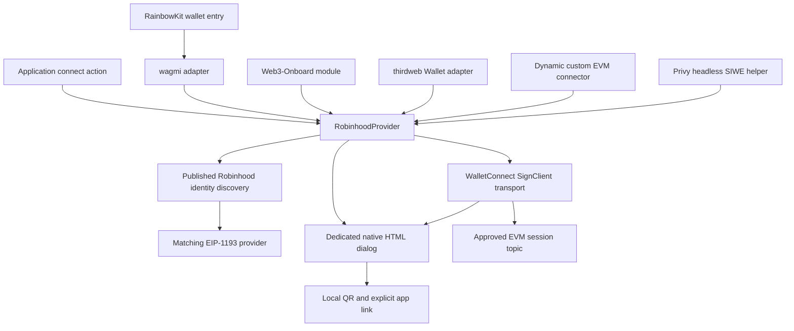

# Architecture

The SDK connects applications to Robinhood Wallet through a matching injected provider or WalletConnect. Its core provider, connection dialog, and framework adapters can be used independently of any application backend or contract deployment.

## Components

The core owns connection intent, timeout, cancellation, current accounts, events, and recovery. The transport owns its approved WalletConnect session topic and translates session events into EIP-1193 state. The modal owns presentation and user cancellation. Framework adapters translate public framework contracts into that common core.

The thirdweb adapter connects with core, then passively adopts accounts through the public EIP-1193 adapter. Its stable outer Wallet recreates internal subscriptions after disconnect, and prevents thirdweb's automatic account-request retries. Dynamic's custom connector translates core account/chain/disconnect events and restores through `getConnectedAccounts()` without requesting permission. The Dynamic example uses connect-only mode.

Privy uses a different boundary: the core owns the wallet connection, while an explicit sign-in action calls Privy's public headless SIWE methods. Its helper invalidates account/chain changes and cancelled operations; if an already-submitted request authenticates late, it calls the host's logout handler. A completed authentication session and wallet connection have independent lifecycles. This does not register a custom Privy wallet-list connector.

`@walletconnect/sign-client` is pinned to **2.26.0**, and `qrcode` to **1.5.4**. There is no AppKit UI dependency and no private RainbowKit controller patch. Framework packages can bring their own unrelated wallet dependencies; this SDK does not assume ownership of their sessions.

## Connect lifecycle

1. Import or construct the provider without requesting accounts. `connect()` or `eth_requestAccounts` is the explicit account-permission entry point. If this connector has a persisted approval, it is recovered first, as wallets answer `eth_requestAccounts` for an existing permission; the steps below run only when recovery fails. `connect()` bounds the recovery wait and any required recovered-session chain switch with the configured connection timeout; cancellation settles its promise without waiting for the wallet. A cancelled recovery cannot adopt a late result or clear a newer recovery job.
2. Discover an EIP-6963 provider advertising `com.robinhood.wallet`, or the published `isRobinhoodMobileWallet` injected flag. Identity hints are not vendor authentication.
3. Request accounts from a matching injected provider. If none is found, lazily initialize the remote transport and show the dedicated dialog when enabled.
4. Offer configured EVM chains and methods to the wallet. Render a returned, validated pairing URI as a local QR and construct the published native app route.
5. Adopt only an active attempt with valid accounts and the requested approved chain. Close its dialog, persist the session selection, and emit provider events.
6. If cancellation, expiry, failure, or a replacement attempt occurs, obsolete completion must not adopt accounts or revive the UI. Late remote approval is disconnected using its original topic.

The default error view rejects the original provider request and leaves an actionable Close view. A new user action in the host creates the retry, so wagmi and other hosts own the result of that new request. The modal's optional `onRetry` callback exists for custom hosts that deliberately own that flow; the default provider does not use it to create a hidden second request.

## Modal and nested framework UI

The dialog uses `showModal()` and the browser top layer. Its background is inert while the dialog is open, including an existing framework wallet chooser. It provides an accessible name, live status, local QR, app link, copy feedback, error details, and keyboard focus management. Escape is consumed before document-level handlers to cancel the SDK attempt while preserving the underlying chooser.

The dialog lives in an open shadow root attached to one `<rhw-connector>` element, the only node it adds to the page. Host page selectors cannot match its controls, and `:host { all: initial !important }` stops inherited host typography at the boundary. Its CSS is a constructed stylesheet where supported, so no inline `<style>` element is needed. Focus restoration follows open shadow roots, so a trigger inside another shadow tree, such as Web3-Onboard's chooser, gets focus back.

The same controls are presented as a centered dialog on wider viewports and a bottom sheet on narrow ones. Viewport width is not used to claim an app is installed. The app is opened only by an explicit anchor click.

Each modal operation carries a generation. Closing or failing clears pairing data and invalidates outstanding QR and clipboard results. A late render cannot update a reopened dialog. QR generation does not use an external image service; the wallet icon is also bundled locally. The QR canvas is drawn at the device pixel ratio (capped at 3×), and the library's fixed inline size is removed so the dialog's square, responsive CSS sizes it.

The RainbowKit adapter intentionally omits its generic `qrCode` and `mobile` display hooks. Their Back navigation has no public signal to cancel this SDK's pending proposal. Using one SDK-owned dialog gives the proposal a single, explicit cancellation boundary. RainbowKit still owns wallet grouping, installed/recent ordering, and other wallet entries.

## RPC, chain, and account boundaries

Configured chain IDs constrain the SDK's requested networks; they are not a compatibility catalog. A remote session must approve the requested chain and accounts. Only permitted wallet methods are forwarded. Supported read methods use the configured RPC endpoint for the current chain, rather than being sent to a wallet as signing requests.

`eth_accounts` returns this provider's cached accounts. `eth_chainId` returns its current hexadecimal chain value, initialized to the first configured chain before any approval. Application code must use connection status and events to distinguish that initial configuration from a confirmed wallet state.

Session events are filtered by owned topic. Account events are checked against approved accounts; removed or invalid authorization clears the connection. Event payloads are decoded as `UniversalProvider` accepts them (numeric, hexadecimal, decimal or CAIP-2 chains; plain or CAIP-10 accounts) before those checks. A session update or repeated chain event keeps the wallet-selected accounts while they remain approved, and only actual changes are emitted. A chain-switch request is checked against application configuration and session permissions, and completion must still refer to the active connection. For WalletConnect, a switch to a chain the session approved is local, because every request names its chain; a chain the session did not approve is rejected with `4901` rather than requested. No constructor, discovery call, or restore flow requests a signature or transaction.

WalletConnect `USER_REJECTED` errors (`5000`–`5003`) from a proposal or request are reported with EIP-1193 code `4001`, keeping the original error as `data`. `cancel()` ends only a pending attempt or recovery; requests on an established connection keep running.

## Persistence and teardown

The provider stores a connection marker under its stable storage prefix; the remote transport stores its owned approved-session selection. WalletConnect maintains the underlying session and cryptographic storage. Independent logical instances should use separate prefixes. Storage failure has a memory fallback for the SDK's own selection state; it holds only values that persistent storage rejected, so a removal by another tab is not masked.

WalletConnect keeps one global Core per storage prefix, and a second SignClient on that Core would add a second engine. Transports with the same prefix therefore share one SignClient for the page; a failed initialization is not cached.

`isAuthorized()` inspects previously approved state and can initialize the transport, but never calls `eth_requestAccounts`. Recovery keeps the saved chain and account selection while the session still approves them, falls back to another approved configured chain when the saved one is no longer configured, and revokes a session that approves no configured chain. A wallet's session extension refreshes the owned expiry. `disconnect()` clears local selection and disconnects the owned remote session and its pairing; revocation is best effort, because a failure (for example while offline) cannot be retried once the local pointer is cleared, so the promise still resolves. Injected-provider disconnect is local; it does not revoke the wallet's permission grant. `destroy()` removes local listeners and UI while preserving an intentionally approved persisted session for recovery by a new instance.

The `display_uri` event contains pairing material. Hosts must not log it, attach it to telemetry, or send it to third-party QR services. The SignClient is configured with silent logging and its telemetry option disabled. Those settings are not a claim that WalletConnect performs no network communication.

## Asset provenance

| Field | Recorded value |
| --- | --- |
| Asset | Robinhood Wallet PNG, embedded as `ROBINHOOD_WALLET.iconUrl` |
| Published listing | [Apple App Store, Robinhood Wallet, ID 1634080733](https://apps.apple.com/app/id1634080733) |
| SHA-256 of embedded PNG | `8036938af96b8d0a7fec88c8bdb8e5fbc1ef59e7759b55d5d59667f7513fa951` |
| Verification | The decoded embedded PNG matched this SHA-256 on 2026-10-17 |

The project does not modify the icon to impersonate a new wallet identity. Robinhood's name, icon, and related marks remain third-party property and are not granted under the project's MIT license. Their use does not establish vendor endorsement or certification.

## Evidence boundaries

The implementation and tests are separate from real-device behavior, registry publication, upstream acceptance, and deployment. See [verification](verification.md) and [upstream contributions](upstream-contributions.md). No Robinhood Chain environment is certified by accepting an arbitrary numeric chain ID.

## Additional frontend consumers

AppKit React uses the existing wagmi connector through `WagmiAdapter` and shares its config with `WagmiProvider`. ConnectKit reads `robinhoodWalletForConnectKit` from its surrounding wagmi provider. That small factory delegates all behavior to the normal connector and uses `type: 'injected'` for ConnectKit 1.9.2's EIP-1193 UI route. It is not a wallet-installation signal and does not change provider discovery. Their choosers do not own the SDK's pairing session or dialog. AppKit is checked on the pinned wagmi v3 baseline; ConnectKit uses wagmi v2 and React 18.

The ethers v6 and viem examples wrap the same core EIP-1193 provider through `BrowserProvider` and `custom`, respectively. Client construction is lazy with respect to account permission. Core owns cancellation, discovery, restoration and disconnect; applications observe core events and clear their own selected signer/account state. The wrappers add no separate transport or SDK package. See the [integration guide](ai-integration.md) for entry points and exact version limits.
