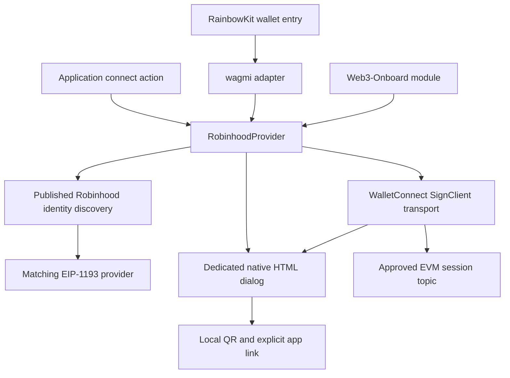

# Architecture

Scope: **TK-465 / RDR-0097 / F-APP-011**, accepted in Vexi spec [PR #327](https://github.com/vexi-v1/vexi-spec/pull/327), merge `712411a1`. This repository is an independent SDK; it does not depend on a Vexi backend, contract deployment, or frontend runtime.

## Components and ownership

The core owns connection intent, timeout, cancellation, current accounts, events, and recovery. The transport owns its approved WalletConnect session topic and translates session events into EIP-1193 state. The modal owns presentation and user cancellation. Framework adapters translate public framework contracts into that common core.

`@walletconnect/sign-client` is pinned to **2.26.0**, and `qrcode` to **1.5.4**. There is no AppKit UI dependency and no private RainbowKit controller patch. Framework packages can bring their own unrelated wallet dependencies; this SDK does not assume ownership of their sessions.

## Connect lifecycle

1. Import or construct the provider without requesting accounts. `connect()` or `eth_requestAccounts` is the explicit account-permission entry point.
2. Discover an EIP-6963 provider advertising `com.robinhood.wallet`, or the published `isRobinhoodMobileWallet` injected flag. Identity hints are not vendor authentication.
3. Request accounts from a matching injected provider. If none is found, lazily initialize the remote transport and show the dedicated dialog when enabled.
4. Offer configured EVM chains and methods to the wallet. Render a returned, validated pairing URI as a local QR and construct the published native app route.
5. Adopt only an active attempt with valid accounts and the requested approved chain. Close its dialog, persist the session selection, and emit provider events.
6. If cancellation, expiry, failure, or a replacement attempt occurs, obsolete completion must not adopt accounts or revive the UI. Late remote approval is disconnected using its original topic.

The default error view rejects the original provider request and leaves an actionable Close view. A new user action in the host creates the retry, so wagmi and other hosts own the result of that new request. The modal's optional `onRetry` callback exists for custom hosts that deliberately own that flow; the default provider does not use it to create a hidden second request.

## Modal and nested framework UI

The dialog uses `showModal()` and the browser top layer. Its background is inert while the dialog is open, including an existing framework wallet chooser. It provides an accessible name, live status, local QR, app link, copy feedback, error details, and keyboard focus management. Escape is consumed before document-level handlers to cancel the SDK attempt while preserving the underlying chooser.

The same controls are presented as a centered dialog on wider viewports and a bottom sheet on narrow ones. Viewport width is not used to claim an app is installed. The app is opened only by an explicit anchor click.

Each modal operation carries a generation. Closing or failing clears pairing data and invalidates outstanding QR and clipboard results. A late render cannot update a reopened dialog. QR generation does not use an external image service; the wallet icon is also bundled locally.

The RainbowKit adapter intentionally omits its generic `qrCode` and `mobile` display hooks. Their Back navigation has no public signal to cancel this SDK's pending proposal. Using one SDK-owned dialog gives the proposal a single, explicit cancellation boundary. RainbowKit still owns wallet grouping, installed/recent ordering, and other wallet entries.

## RPC, chain, and account boundaries

Configured chain IDs constrain the SDK's requested networks; they are not a compatibility catalog. A remote session must approve the requested chain and accounts. Only permitted wallet methods are forwarded. Supported read methods use the configured RPC endpoint for the current chain, rather than being sent to a wallet as signing requests.

`eth_accounts` returns this provider's cached accounts. `eth_chainId` returns its current hexadecimal chain value, initialized to the first configured chain before any approval. Application code must use connection status and events to distinguish that initial configuration from a confirmed wallet state.

Session events are filtered by owned topic. Account events are checked against approved accounts; removed or invalid authorization clears the connection. A chain-switch request is checked against application configuration and session permissions, and completion must still refer to the active connection. No constructor, discovery call, or restore flow requests a signature or transaction.

## Persistence and teardown

The provider stores a connection marker under its stable storage prefix; the remote transport stores its owned approved-session selection. WalletConnect maintains the underlying session and cryptographic storage. Independent logical instances should use separate prefixes. Storage failure has a memory fallback for the SDK's own selection state.

`isAuthorized()` inspects previously approved state and can initialize the transport, but never calls `eth_requestAccounts`. `disconnect()` clears local selection and disconnects the owned remote session. Injected-provider disconnect is local; it does not revoke the wallet's permission grant. `destroy()` removes local listeners and UI while preserving an intentionally approved persisted session for recovery by a new instance.

The `display_uri` event contains pairing material. Hosts must not log it, attach it to telemetry, or send it to third-party QR services. The SignClient is configured with silent logging and its telemetry option disabled. Those settings are not a claim that WalletConnect performs no network communication.

## Asset provenance

| Field | Recorded value |
| --- | --- |
| Asset | Robinhood Wallet PNG, embedded as `ROBINHOOD_WALLET.iconUrl` |
| Published listing | [Apple App Store, Robinhood Wallet, ID 1634080733](https://apps.apple.com/app/id1634080733) |
| Existing source asset | `vexi-frontend/public/icons/wallets/robinhood.png` |
| SHA-256 of embedded PNG | `8036938af96b8d0a7fec88c8bdb8e5fbc1ef59e7759b55d5d59667f7513fa951` |
| Verification | Decoded embedded PNG hash checked against the recorded source hash on 2026-10-17 |

The project does not modify the icon to impersonate a new wallet identity. Robinhood's name, icon, and related marks remain third-party property and are not granted under the project's MIT license. Their use does not establish vendor endorsement or certification.

## Evidence boundaries

The implementation and tests are separate from real-device behavior, registry publication, upstream acceptance, and deployment. See [verification](verification.md) and [upstream contributions](upstream-contributions.md). No Robinhood Chain environment is certified by accepting an arbitrary numeric chain ID.
