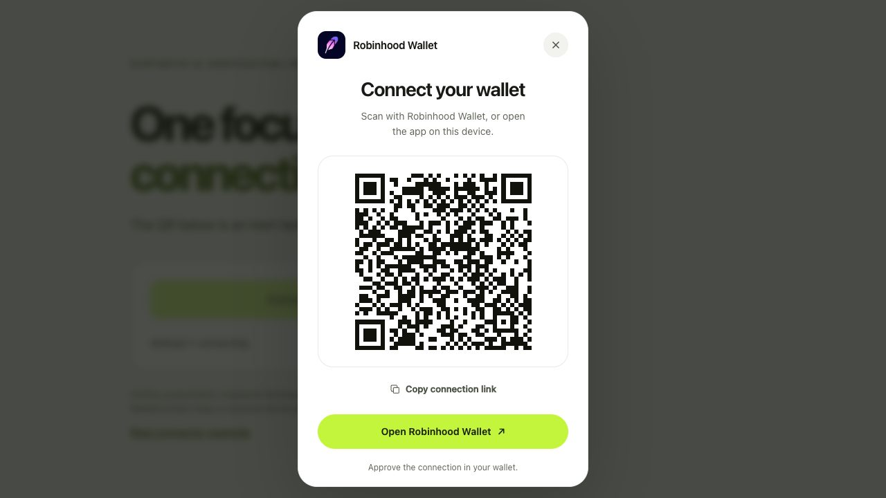
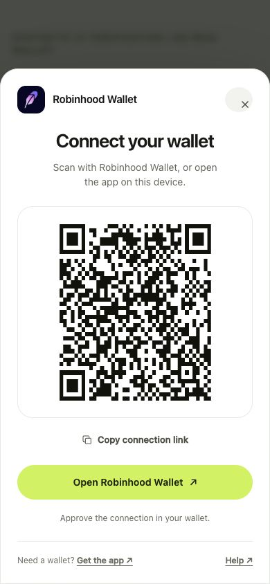

# Verification record

## Complete example suite — 2026-10-17

`npm run test:all` completed successfully against the working tree based on `fc8774a6a3231a4c1af143091dc8f34f517b2054`. The command builds and type-checks all seven SDK packages, runs core tests and documentation checks, then validates all twelve packed examples and their browser flows. [Matrix evidence](evidence/2026-10-17/complete-suite/framework-matrix.json) records 109 source/build input hashes, root configuration hashes, exact installed versions and packed artifacts. [Check output](evidence/2026-10-17/complete-suite/framework-checks.log) preserves the passing results with temporary paths sanitized. These checks ran locally before committing the changes. Packages remain unpublished and undeployed; this record does not establish a merge or remote CI result.

| Check | Outcome | Scope |
| --- | --- | --- |
| SDK build and type check | **Passed** | All seven SDK packages. |
| Core unit suite | **40 passed** | Synthetic discovery, provider, transport and modal behavior. |
| Packed examples | **12 builds/type contracts and 79 runtime tests passed** | Vanilla (7), wagmi v2 (4), wagmi v3 (4), RainbowKit (7), Onboard (3), AppKit (5), ConnectKit (6), ethers (5), viem (5), thirdweb (9), Dynamic (8), Privy (16). |
| Browser examples | **48 scenarios passed** | All twelve examples, two scenarios each at 1280×720 and 390×844, using Playwright 1.64.1 / Chromium 156.0.8078.4. [Browser evidence](evidence/2026-10-17/complete-suite/browser.json). |
| Documentation | **Passed** | Generated bundle freshness and link checks across 29 documents. |
| CI configuration | **Updated** | Installs Playwright Chromium and invokes `npm run test:all`; no remote CI execution is claimed. |

The expanded browser run exposed a RainbowKit example issue: its default generic Browser Wallet entry could restore the same injected approval alongside the Robinhood connector. Disconnecting Robinhood then left the generic connection active. The example now retains that entry's branding while using a targetless wagmi injected connector, which restores only after that entry was explicitly selected. The regression test verifies both rejection of Robinhood-only approval and successful explicit generic connection. The status line now distinguishes `reconnecting` from `connected`, and the native account menu disconnect/reload path passes in both viewports.

The browser suite checks no permission request on page load, explicit synthetic connection, reload behavior, disconnect and listener cleanup. Ten examples restore approved state without another permission request. Vanilla and Onboard deliberately require a second explicit connection after reload; neither prompts automatically. The second scenario verifies one SDK dialog with blocked remote traffic, contained keyboard focus, Escape cancellation and explicit retry through each host's controls. Unknown/missing case selections and incomplete scenario counts fail the runner. The final browser pass repeats all 48 scenarios against the same packed builds after allowing chooser animations to finish before captures.

All external HTTP/WebSocket traffic is blocked; Dynamic uses the local public-configuration fixtures described below. The synthetic signing/transaction guard records zero requests in all 24 injected-wallet scenarios. No real wallet, live platform authentication, signature, transaction or network certification is established. Screenshots contain only disconnected pages/choosers before approval: [RainbowKit](evidence/2026-10-17/complete-suite/rainbowkit-chooser-390.png), [Onboard](evidence/2026-10-17/complete-suite/onboard-chooser-390.png), [Vanilla](evidence/2026-10-17/complete-suite/vanilla-1280.png), [Dynamic](evidence/2026-10-17/complete-suite/dynamic-chooser-390.png), [Privy](evidence/2026-10-17/complete-suite/privy-390.png).

Reproduce with `npx playwright install chromium` followed by `npm run test:all`; an installed Chrome browser can instead use `BROWSER_CHANNEL=chrome npm run test:all`. For selected examples, use `node scripts/framework-matrix.mjs rainbowkit onboard --browser`. See [CONTRIBUTING.md](../CONTRIBUTING.md#validate-a-change) for separate commands and the earlier records below for integration baselines and remaining verification limits.

## Expanded platform integrations — 2026-10-17

The earlier platform run verified the working tree based on `fc8774a6a3231a4c1af143091dc8f34f517b2054`, including AppKit, ConnectKit, ethers, viem and the new thirdweb, Dynamic and Privy packages. At the time of this run, the changes were not committed, merged, published or deployed. The [matrix evidence](evidence/2026-10-17/platform-integrations/framework-matrix.json) records 100 runtime/build input hashes, the root manifests, exact installed top-level versions and all seven packed SDK hashes. Temporary paths are sanitized; `originalReportSha256` ties this record to the original matrix report used by the browser checks.

| Check | Outcome | Scope |
| --- | --- | --- |
| SDK build and type check | **Passed** | All seven SDK packages, including the three new adapters/helpers. |
| Core unit suite | **40 passed** | Synthetic discovery, provider, transport and modal checks; core source is unchanged. |
| Packed consumers | **11 builds/type contracts and 71 runtime tests passed** | Fresh isolated installs: wagmi v2 (4), wagmi v3 (4), RainbowKit (6), Onboard (3), AppKit (5), ConnectKit (6), ethers (5), viem (5), thirdweb (9), Dynamic (8), Privy (16). [Check output](evidence/2026-10-17/platform-integrations/framework-checks.log). |
| Browser integration checks | **28 scenarios passed** | Seven examples at 1280×720 and 390×844; two scenarios per viewport. [Browser record](evidence/2026-10-17/platform-integrations/browser.json). |
| Agent documentation | **Generation and link/freshness checks passed** | Canonical guides, `llms.txt` and generated `llms-full.txt` cover the new packages and their limits. |

The added baselines are **thirdweb 5.122.0**, **Dynamic React 5.12.0** (`sdk-react-core`, `ethereum-core`, `wallet-connector-core`) and **Privy React 3.50.0**, with React / React DOM **19.3.1**. Dynamic and Privy use viem **2.57.7**. Existing AppKit, ConnectKit, ethers and viem baselines are listed in the earlier record below and were rechecked in this full matrix. Dynamic uses bundler module resolution for its upstream declarations. Inherited dependency/peer warnings are described in [dependency notes](dependency-notes.md); no new dependency audit or security certification is claimed.

thirdweb is tested as a standard Wallet with a custom connection button and active-wallet hooks. Dynamic is tested as a custom connector in its React SDK's native wallet chooser, in connect-only mode. Privy uses the public headless `useLoginWithSiwe` flow after a separate core connection; it does not register this wallet in Privy's chooser or `useWallets()`. Packed tests cover server imports/rendering, account and chain events, cancellation and late approval, rejection without automatic retries, disconnect/reconnect, saved approval and listener cleanup. Privy additionally uses deliberately invalid synthetic signatures and in-process callbacks to verify stale sign-in suppression, immediate listener cleanup and logout after a late authentication callback. No signature is sent to a platform.

Browser checks run the packed production builds in Chrome **155.0.8059.82** through Playwright **1.64.1**. Each example passes synthetic injected connection, reload recovery without another permission request, disconnect and listener cleanup; the second scenario covers a blocked remote transport, one SDK dialog, contained keyboard focus, Escape cancellation and explicit retry. External HTTP and WebSocket traffic is blocked. Dynamic receives local synthetic public configuration, an unrelated wallet-book entry and an empty nonce list so its real chooser can render; no platform authentication response is simulated. A synthetic guard rejects and counts signing/transaction requests, and the final count is zero in every injected-wallet scenario. Privy's sign-in button is never clicked. Narrow viewports are desktop-browser layout checks, not physical mobile-device results.

Reproduce with `npm run build`, `npm run typecheck`, `npm test`, `node scripts/framework-matrix.mjs`, then `BROWSER_CHANNEL=chrome node scripts/browser-integrations.mjs /path/to/matrix/report.json`. See [CONTRIBUTING.md](../CONTRIBUTING.md#validate-a-change) for browser setup. The browser record includes hashes for both the runner and its platform fixtures. Captures contain only disconnected pages/choosers: [Dynamic desktop](evidence/2026-10-17/platform-integrations/dynamic-chooser-1280.png), [Dynamic narrow viewport](evidence/2026-10-17/platform-integrations/dynamic-chooser-390.png), [thirdweb desktop](evidence/2026-10-17/platform-integrations/thirdweb-1280.png), [Privy narrow viewport](evidence/2026-10-17/platform-integrations/privy-390.png).

Live Dynamic/Privy authentication, thirdweb's built-in chooser, physical Robinhood Wallet pairing, actual signatures/transactions and network certification remain unverified. The evidence below is historical and retains its original scope.

## Additional frontend integrations — 2026-10-17

The initial frontend run verified the working tree based on `fc8774a6a3231a4c1af143091dc8f34f517b2054`, including the new `robinhoodWalletForConnectKit` export and four runnable examples. It is not a claim that these changes are already merged, published or deployed. [Matrix evidence](evidence/2026-10-17/frontend-integrations/framework-matrix.json) records the base commit, modified-working-tree flag, input/source hashes, exact installed top-level versions and packed SDK hashes. Temporary paths are sanitized; `originalReportSha256` identifies the original matrix report consumed by the browser check.

| Check | Outcome | Scope |
| --- | --- | --- |
| SDK build and type check | **Passed** | All four existing SDK packages; one new thin ConnectKit factory reuses the wagmi lifecycle. |
| Core unit suite | **40 passed** | Synthetic provider, transport, discovery and modal checks. |
| Packed consumers | **8 builds/type contracts and 38 runtime tests passed** | wagmi v2 (4), wagmi v3 (4), RainbowKit (6), Onboard (3), AppKit (5), ConnectKit (6), ethers (5), viem (5). [Check output](evidence/2026-10-17/frontend-integrations/framework-checks.log). |
| Browser integration checks | **16 scenarios passed** | Each new example at 1280×720 and 390×844: synthetic injected connection/reload/disconnect/cleanup, plus one SDK dialog, keyboard cancellation and retry with external traffic blocked. [Browser record](evidence/2026-10-17/frontend-integrations/browser.json). |
| Agent documentation | **Generation and link/freshness checks passed** | Updated canonical guides, `llms.txt` and generated `llms-full.txt`. |

The new baselines are AppKit and its wagmi adapter **1.8.24** with wagmi **3.7.7** / core **3.6.5** / React **19.3.1**; ConnectKit **1.9.2** with wagmi **2.19.5** / core **2.22.1** / React **18.3.1**; ethers **6.17.0**; and viem **2.57.7**. Both wagmi consumers use viem **2.57.7**. AppKit's wagmi v2 combination failed on an upstream optional dependency's `@wagmi/core/tempo` import and is not part of the supported example. ConnectKit's helper supplies its required EIP-1193 chooser routing without changing Robinhood provider discovery; an unrelated injected provider is explicitly rejected by a regression test.

Reproduce the packed matrix with `node scripts/framework-matrix.mjs`, then run `node scripts/browser-integrations.mjs /path/to/matrix/report.json` using Playwright Chromium (or `BROWSER_CHANNEL=chrome` for installed Chrome). The [contributor guide](../CONTRIBUTING.md#validate-a-change) includes setup. Browser tests block external HTTP and WebSocket traffic, approve only a synthetic injected wallet, and capture only disconnected pages/choosers before account or pairing material exists. These results do not add live-relay, physical-device, signature, transaction or chain-certification evidence. Dependency audits for the new consumers were not refreshed; the historical audit below remains scoped to its original installs.

Disconnected chooser captures: [AppKit desktop](evidence/2026-10-17/frontend-integrations/appkit-chooser-1280.png), [ConnectKit narrow viewport](evidence/2026-10-17/frontend-integrations/connectkit-chooser-390.png).

## Original delivery evidence

Verification recorded on **2026-10-17**. The original delivery was verified at source `f6958cf6798c0c7e35961e2ee2779af855239249`, merged as `c117311a621af2f7819bdf6a407115733feccd3e` with an identical Git tree. The AI follow-up review changes were verified on their own tree before merge; rows and sections marked follow-up refer to those checks. A supplemental merge review then corrected two additional lifecycle regressions; see the separate merge-review record below. A command listed under reproduction is an instruction, not evidence that it has passed.

The repository was subsequently renamed to `vexi-v1/robinhood-wallet-connector`, and repository URLs were corrected in package metadata and documentation. Provider and adapter source did not change. Recorded tarball hashes identify the tested artifacts before that metadata correction; newly packed artifacts can have different hashes.

## Supplemental merge review

Review of PR #7 at `ef547350d99170d746bc21e979bab0dba0e16094` reproduced two additional regressions: a stalled saved-session recovery ignored connection timeout/cancellation, and a disconnect during a preferred-chain switch could return a successful empty-account result. The supplemental fix bounds and cancels recovery through any required chain switch, protects retries from old completion, and rejects obsolete adapter results. The reconnect authorization preflight is guarded as part of the same adapter attempt.

Local build and type checks passed on Node.js 24.19.0. The full core suite passed **68/68**, including five added tests and a stronger existing cancellation assertion. The original follow-up's R02 is resolved: cancelling a stalled recovery and retrying can recover the saved session without a new pairing; the old recovery cannot overwrite or clear the new one. Final source review found no remaining blocker in the changed paths. This is AI review with synthetic wallets, not human review or a security audit.

See the [supplemental evidence](evidence/2026-10-17/merge-review.json) for exact source hashes, packed-consumer results and limitations. PR checks record validation of the final submitted commit. The earlier **63-test / 21-consumer-test** results and browser observations below are historical follow-up evidence, not a rerun of the supplemental tree.

## Recorded checks

| Check | Recorded outcome | Evidence boundary |
| --- | --- | --- |
| All four SDK packages | **Build passed** | TypeScript build of core and three adapters. |
| Core behavioral suite | **63 passed** | Follow-up: discovery 5, modal 13, provider 27, transport 16, storage 2; synthetic EIP-1193 / SignClient fixtures and JSDOM. `npm run typecheck` also type-checks the test files. Passed on Node.js 24.19.0 and on the declared minimum, 22.12.0. The original delivery recorded 40. |
| Packed framework consumers | **4 builds/type contracts and 21 runtime tests passed** | Follow-up, fresh installs of real wagmi v2/v3, RainbowKit and Onboard packages: wagmi v2 5, wagmi v3 5, RainbowKit 7, Onboard 4. Historical follow-up [tarball hashes and versions](evidence/2026-10-17/follow-up-review.json); the original delivery run (4 builds, 14 runtime tests) is in the [matrix evidence](evidence/2026-10-17/framework-matrix.json). |
| Actual browser flow | **Passed within the scope below** | Original delivery: local examples in a Chromium browser with a real relay proposal and no wallet approval. Follow-up: headless Chromium on the synthetic fixture and on production framework builds with all non-local network blocked. |
| AI code review | **No remaining actionable blocker in reviewed paths** | Cancellation, session ownership, account permissions, asynchronous switching and event reentrancy; regressions recorded in [review evidence](evidence/2026-10-17/review.json). |
| AI follow-up review | **26 confirmed issues fixed; 7 items recorded at that stage** | One primary and two independent AI reviews of the core and adapters against real framework and WalletConnect source. Each fix has a regression test or browser measurement, listed in the [follow-up evidence](evidence/2026-10-17/follow-up-review.json). Not a human approval or security audit. R02 was subsequently resolved by the merge review below. |
| Dependency audit | **Core and wagmi v3: zero reported findings; legacy frameworks have findings** | Onboard includes inherited critical findings. See [dependency notes](dependency-notes.md); this is not a security certification. |
| Embedded icon hash | **Matched** recorded SHA-256 | See [asset provenance](architecture.md#asset-provenance). |
| Real mobile wallet pairing, signatures, transactions | **Not performed** | No physical-device or chain certification. |
| npm publication, external upstream acceptance, deployment | **Not performed** | Repository delivery does not establish these states. |

The original delivery's final core tarball SHA-256 was `e635001e95f65fa43bb2fad1831a97b56f6c28af1a6feb6e18f79617ba9d7335`. The historical follow-up core tarball SHA-256, packed with the corrected repository metadata before the supplemental merge fixes, was `b8d7bbc700c994c9fde7daf871eaacbe6cca5a6952512cf7bec8a805238429cc`; adapter hashes and environment versions are in the follow-up evidence. No real pairing URI, session key, account address, or wallet approval is included in the committed evidence.

## Reproduce local checks

```sh
npm ci
npm run build
npm run typecheck
npm test
node scripts/framework-matrix.mjs
```

The framework matrix writes `report.json` plus installation, build, and runtime logs into its printed temporary directory. It packs all SDK packages, computes tarball hashes, creates isolated consumer applications, installs real framework packages, type-checks/builds the examples, and runs synthetic provider lifecycle tests. Its nonempty synthetic project ID keeps connector code in the production bundle; it is not a usable relay credential.

Declared framework baselines are wagmi `2.19.5` / core `2.22.1`, wagmi `3.7.7` / core `3.6.5`, RainbowKit `2.2.11` with wagmi v2, and Web3-Onboard core `2.24.1` / common `2.4.2`. Viem is `2.57.7`. Exact resolved versions and artifacts belong in the final matrix report.

## Observed browser checks

The [browser record](evidence/2026-10-17/browser.json) separates synthetic layout checks from actual relay initialization. Screenshots use a deliberately inert fixture QR and must never be used for wallet pairing.

### Follow-up checks

These ran after the follow-up fixes, before the supplemental merge-review changes, in headless Chrome for Testing 153. They were not repeated for the supplemental changes. The synthetic fixture page was also served with an aggressive host stylesheet and with `Content-Security-Policy: style-src 'self'`. The framework pages are the packed-consumer production builds, with every request and WebSocket to a host other than `127.0.0.1` blocked. Details are in the [follow-up evidence](evidence/2026-10-17/follow-up-review.json).

| Scenario | Before the fixes | After the fixes |
| --- | --- | --- |
| Fixture, 390×844 and 320×640 | QR displayed 240×280 (squashed); close icon off-center by (9, 7) px from the example's own `button` CSS | QR 240×240; icon centered; backing canvas 840 px at 3× |
| Fixture, 1280×720 at 2× | QR backing canvas 280 px (upscaled) | 560 px |
| Hostile host CSS | QR shrunk to 40×40, title recolored, text uppercased, close button overflowing | No host style reaches the dialog |
| `style-src 'self'` policy | Inline `<style>` blocked; dialog unstyled | No violation; fully styled |
| Keyboard | Covered by unit tests | Initial focus on Close; Tab and Shift+Tab cycle inside the dialog; background inert; Close and Escape restore focus to Connect |
| RainbowKit build, network blocked | Not run | One SDK top-layer dialog over the chooser, which cannot take focus; Escape closes only the SDK dialog; RainbowKit's Retry opens a fresh one |
| Web3-Onboard build, network blocked | Not run | SDK dialog opens; Escape leads to Onboard's "Connection Rejected! Click here to try again" |
| wagmi v3 build at 390×844, network blocked | Not run | Escape returns to disconnected with focus on Connect |

On the wagmi v3 page, which loads only this SDK's connector, the only blocked host was the WalletConnect relay WebSocket. The WalletConnect telemetry and AppKit configuration hosts appeared only on the RainbowKit page, which also includes RainbowKit's own WalletConnect connector.

### Original delivery checks

The checks below were recorded on 2026-10-16 against the original delivery, before the follow-up changes, and were not repeated afterward. The real-relay rows need a project ID and should be re-run before relying on them for the current dialog.

| Scenario | Observed result |
| --- | --- |
| Desktop and narrow fixture | One native top-layer dialog; local canvas QR; Robinhood name, app action, copy and help controls; no horizontal page or dialog overflow. Narrow layout uses a bottom sheet. |
| Fixture keyboard cancellation | Escape closes the dialog, returns the provider to idle and restores focus to the Connect button after its disabled state clears. Focus wrap and stale completion are also covered by modal tests. |
| Vanilla real relay | Ready QR and native Robinhood app action appeared. Cancel rejected the attempt; another Connect produced a fresh ready dialog. |
| RainbowKit real relay | Robinhood appears first in the Recommended group. Selecting it opens the SDK top-layer dialog, making the host chooser inert. Escape returns to the host chooser; its Retry action opens a fresh ready SDK dialog. Closing the chooser returns focus to Connect Wallet. |
| Web3-Onboard real relay | Selecting the module opens the ready SDK dialog. Expiry clears pairing data and shows an actionable error. Close/ Escape returns to the host rejection state; Back to wallets and the host Retry action both lead to a fresh ready SDK dialog. |
| wagmi v3 real relay | Connect opens the ready SDK dialog. Escape returns to disconnected; another Connect opens a fresh ready dialog. The final host focus refinement restores focus to Connect after cancellation and both wagmi examples passed renewed type/build checks. |

The screenshots below were recaptured after the follow-up fixes; the earlier versions, which show the squashed narrow QR and off-center close icon, remain in the repository history.





## Physical-device validation remains separate

For manual device testing, record the device model, OS, browser, Robinhood Wallet version, app origin, connector commit/tarball hash, and tested chain for each result. Use a dedicated test wallet and do not put addresses, pairing URIs, session keys, or signing material in public evidence.

1. Desktop QR to real iOS and Android wallet: scan, approve, verify account/chain result, reject, cancel, timeout, and retry. Record the error code the host receives for a wallet rejection; the SDK reports WalletConnect's `USER_REJECTED` as `4001`.
2. Same-device app handoff: explicit app-link click, successful return to the dapp, and browser behavior when the wallet is not installed. Note whether a later signing request needs a manual switch back to the wallet; the SDK does not reopen the app for requests.
3. Injected Robinhood in-app browser: discovery, user-triggered permission request, account changes, and rejected/removed authorization. With RainbowKit, confirm that connecting on a non-default configured chain shows no switch prompt.
4. Reload recovery and disconnect: recover only the intended prior approval, including through a Connect action after reload, without a new pairing; disconnect removes it; stale approval cannot revive a cancelled request.
5. Each intended network: approve it, verify actual chain selection, and exercise supported switch/rejection behavior. For WalletConnect, a switch between chains the session approved is local and shows no wallet prompt; confirm the wallet honors the next request on the selected chain. Record each mainnet and testnet separately.
6. Signing and transactions: connection checks do not require either operation. If you test them separately, use a dedicated test wallet, review every wallet prompt, and record the exact method, expected outcome and network.

Until that evidence exists, this project must not advertise physical-wallet certification or universal EVM/Robinhood Chain support.
