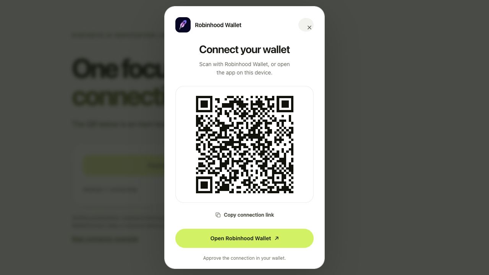

# Verification record

Working record for **TK-465**, dated **2026-10-17**. Checks below concern the local working tree unless a commit or packaged artifact is explicitly identified. A command listed under reproduction is an instruction, not evidence that it has passed.

## Recorded checks

| Check | Recorded outcome | Evidence boundary |
| --- | --- | --- |
| All four SDK packages | **Build passed** | TypeScript build of core and three adapters. |
| Core behavioral suite | **40 passed** | Discovery 5, modal 10, provider 16, transport 9; synthetic EIP-1193 / SignClient fixtures and JSDOM. |
| Packed framework consumers | **4 builds/type contracts and 14 runtime tests passed** | Real wagmi v2/v3, RainbowKit and Onboard packages; [exact versions, tarball hashes, method and logs](evidence/tk-465/framework-matrix.json). Four initially fresh installs followed by the final core-only offline refresh and repeated checks. |
| Actual browser flow | **Passed within the scope below** | Local examples in a Chromium browser; desktop 1280×720 and narrow 390×844 fixture layout. Real relay proposal generation without wallet approval. |
| Independent code review | **No remaining actionable blocker in reviewed paths** | Cancellation, session ownership, account permissions, asynchronous switching and event reentrancy; regressions recorded in [review evidence](evidence/tk-465/review.json). |
| Dependency audit | **Core and wagmi v3: zero reported findings; legacy frameworks have findings** | Onboard includes inherited critical findings. See [dependency notes](dependency-notes.md); this is not a security certification. |
| Embedded icon hash | **Matched** recorded SHA-256 | See [asset provenance](architecture.md#asset-provenance). |
| Real mobile wallet pairing, signatures, transactions | **Not performed** | No physical-device or chain certification. |
| npm publication, external upstream acceptance, deployment | **Not performed** | Repository delivery does not establish these states. |

The final core tarball SHA-256 is `e635001e95f65fa43bb2fad1831a97b56f6c28af1a6feb6e18f79617ba9d7335`. Exact adapter hashes and environment versions are in the matrix evidence. No real pairing URI, session key, account address, or wallet approval is included in the committed evidence.

## Reproduce local checks

```sh
npm ci
npm run build
npm run typecheck
npm test
node scripts/framework-matrix.mjs
```

The framework matrix writes `report.json` plus installation, build, and runtime logs into its printed temporary directory. It packs all SDK packages, computes tarball hashes, creates isolated consumer applications, installs real framework packages, type-checks/builds the examples, and runs synthetic provider lifecycle tests. Its nonempty synthetic project ID keeps connector code in the production bundle; it is not a usable relay credential.

Declared framework baselines are wagmi `2.19.5` / core `2.22.1`, wagmi `3.7.7` / core `3.6.5`, RainbowKit `2.2.11` with wagmi v2, and Web3-Onboard core `2.24.1` / common `2.4.2`. Viem is `2.57.7`. Exact resolved versions and artifacts belong in the final matrix report.

## Observed browser checks

The [browser record](evidence/tk-465/browser.json) separates synthetic layout checks from actual relay initialization. Screenshots use a deliberately inert fixture QR and must never be used for wallet pairing.

| Scenario | Observed result |
| --- | --- |
| Desktop and narrow fixture | One native top-layer dialog; local canvas QR; Robinhood name, app action, copy and help controls; no horizontal page or dialog overflow. Narrow layout uses a bottom sheet. |
| Fixture keyboard cancellation | Escape closes the dialog, returns the provider to idle and restores focus to the Connect button after its disabled state clears. Focus wrap and stale completion are also covered by modal tests. |
| Vanilla real relay | Ready QR and native Robinhood app action appeared. Cancel rejected the attempt; another Connect produced a fresh ready dialog. |
| RainbowKit real relay | Robinhood appears first in the Recommended group. Selecting it opens the SDK top-layer dialog, making the host chooser inert. Escape returns to the host chooser; its Retry action opens a fresh ready SDK dialog. Closing the chooser returns focus to Connect Wallet. |
| Web3-Onboard real relay | Selecting the module opens the ready SDK dialog. Expiry clears pairing data and shows an actionable error. Close/ Escape returns to the host rejection state; Back to wallets and the host Retry action both lead to a fresh ready SDK dialog. |
| wagmi v3 real relay | Connect opens the ready SDK dialog. Escape returns to disconnected; another Connect opens a fresh ready dialog. The final host focus refinement restores focus to Connect after cancellation and both wagmi examples passed renewed type/build checks. |




## Physical-device validation remains separate

An authorized human should record device model, OS, browser, Robinhood Wallet version, app origin, connector commit/tarball hash, and tested chain for each result. Use a dedicated test wallet and do not put addresses, pairing URIs, session keys, or signing material in public evidence.

1. Desktop QR to real iOS and Android wallet: scan, approve, verify account/chain result, reject, cancel, timeout, and retry.
2. Same-device app handoff: explicit app-link click, successful return to the dapp, and browser behavior when the wallet is not installed.
3. Injected Robinhood in-app browser: discovery, user-triggered permission request, account changes, and rejected/removed authorization.
4. Reload recovery and disconnect: recover only the intended prior approval; disconnect removes it; stale approval cannot revive a cancelled request.
5. Each intended network: approve it, verify actual chain selection, and exercise supported switch/rejection behavior. Record mainnet `4663` and testnet `46630` separately if requested.
6. Signing and transactions: only under an explicit separate test scope, with the exact method, user review, expected outcome, and network recorded. SDK connection testing does not require these operations.

Until that evidence exists, this project must not advertise physical-wallet certification or universal EVM/Robinhood Chain support.
